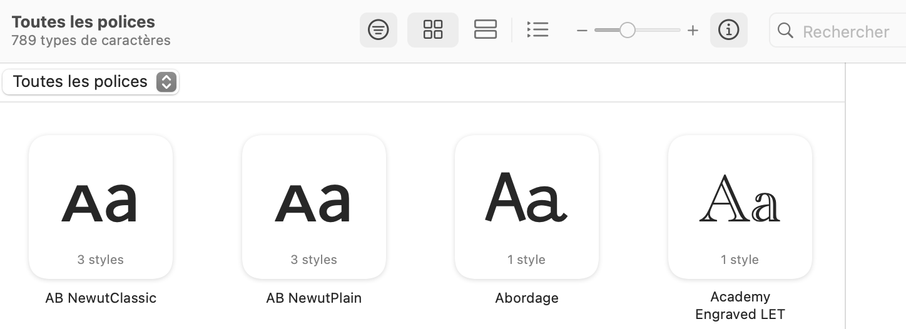
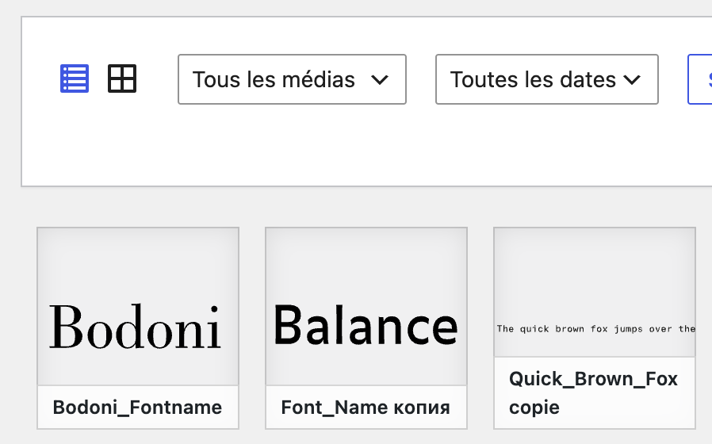
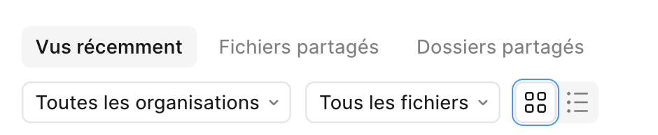

## Objectif:

Mise à jour du site [fontes.eracom.ch](https://fontes.eracom.ch/)

Archive du site à importer dans local: [Lien Onedrive](https://eduvaud-my.sharepoint.com/:f:/r/personal/pr51kln_eduvaud_ch/Documents/Divers/Archives%20Sites%20Local?d=wce53efe32f8348d5b54e03add7df0860&csf=1&web=1&e=tGVUctE)

## Problèmes à résoudre:

### Rapidité du filtrage

Problème technique: le filtrage des fontes repose sur une méthode disponible par Bricks, qui effectue une requête côté serveur. Cela cause une certaine lenteur de l'interface, c'est loin d'être immédiat.

Ce qui serait mieux: puisque dans l'état initial du site, toutes les fontes sont déjà présentes, il serait plus logique d'effectuer ce filtrage par Javascript, sans faire de requête à la base de données (simplement afficher masquer les fontes).

Méthode pour résoudre cela: se faire aider par un LLM.

Ce qu'on veut: 

1. Disposer les éléments avec CSS Grid ou Flexbox.
2. Basculer une classe ou l’attribut `hidden` sur les éléments quand on clique sur un bouton de filtre.
3. Animer le réagencement avec l’API View Transitions (`document.startViewTransition(() => ...)`), qui donne un repositionnement animé façon Isotope avec très peu de code. Elle est prise en charge par les navigateurs Chromium et Safari récents.

Cela couvre la plupart des cas simples en une vingtaine de lignes.

Exemples d'utilitaires de filtrage Javascript: 

- Isotope, un projet célèbre par David DeSandro, mais ancien (de 2010 à 2020): https://github.com/metafizzy/isotope/
- [Shuffle.js](https://shuffle.js.org)
- "I saw the Isotope filter by David DeSandro and I just had to write a rebuild using modern web standards." [code.usecue.com/filter/](https://code.usecue.com/filter/)

### Permettre des affichages plus compacts

Proposer plusieurs options d'affichage des types (p.ex. en grille). Un bouton doit permettre de changer l'affichage. Exemples: filtrage dans le livre des polices, dans les médias de WordPress, dans un dossier de projets Figma.

### Compléter les fontes manquantes

Organiser des classes (p.ex. élèves LAB) pour introduire dans le site des fontes manquantes. Actuellement: 46 fontes publiées.